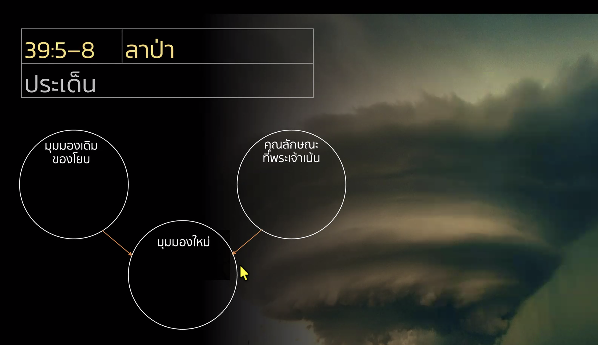
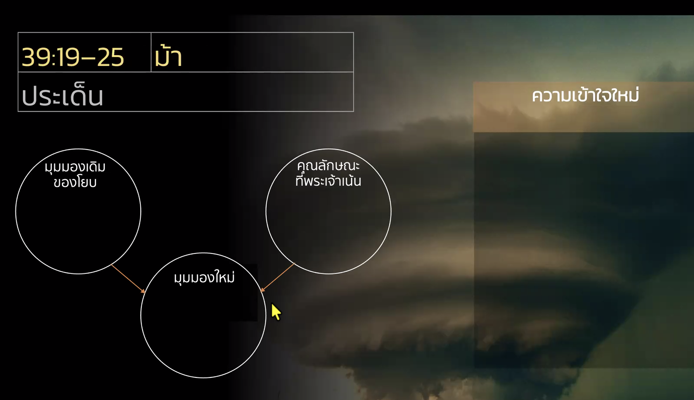
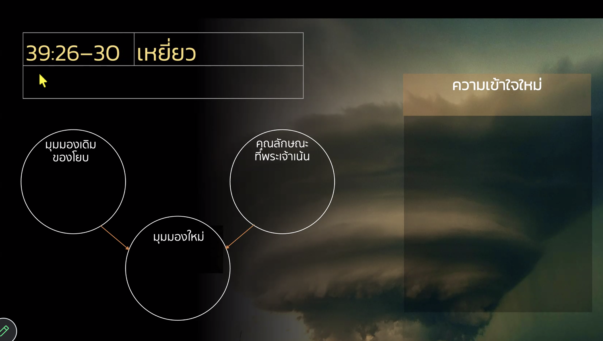
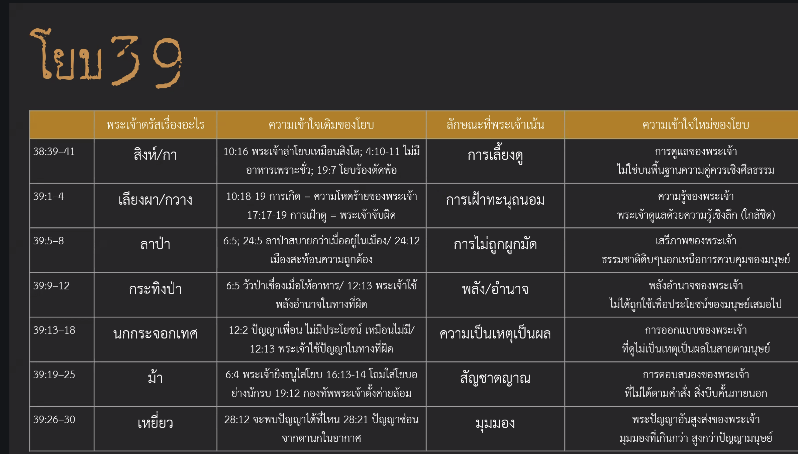

วิดีโอนี้เป็นการศึกษาพระคัมภีร์เรื่อง **หนังสือโยบ บทที่ 39** โดย อ.ธนิต โลเกศกระวี และทีมงานชูใจ ซึ่งถือเป็นคำตรัสครั้งที่ 2 ของพระเจ้าที่ตอบต่อโยบ หลังจากที่บทที่ 38 พระเจ้าได้พาโยบไปดูความยิ่งใหญ่ของจักรวาล แต่ในบทนี้พระเจ้าเปลี่ยนแนวทางมาเป็นการพาไปชม **"ซาฟารี" หรือสวนสัตว์เปิด** เพื่อชี้ให้เห็นถึงความเป็นจริงของโลกที่อยู่เหนือกรอบความคิดของมนุษย์

**ประเด็นสำคัญที่ได้เรียนรู้:**
* **การทลายกรอบความคิด:** พระเจ้าใช้ตัวอย่างสัตว์ป่า เช่น สิงโต, อีกา, เรียงผา, กวาง, ลาป่า, วัวกระทิง, นกกระจอกเทศ, ม้า, เหยี่ยว และนกอินทรีย์ มาเป็นบทเรียนเพื่อสอนโยบว่า พระเจ้าเป็นผู้ดูแลและควบคุมทุกอย่างในธรรมชาติ แม้สิ่งที่มนุษย์ควบคุมไม่ได้หรือเข้าใจไม่ถึง
* **การดูแลของพระเจ้า:** พระเจ้าทรงเฝ้าดูการเกิดและการดำเนินชีวิตของสัตว์ทุกชนิด (07:15 - 08:37) ซึ่งเป็นการสะท้อนว่าการเกิดของโยบไม่ใช่เรื่องโหดร้ายหรือคำสาปแช่งอย่างที่โยบเคยเข้าใจ แต่พระเจ้าทรงเฝ้าดูและมีแผนการที่ลึกซึ้งกว่านั้น
* **เสรีภาพและอำนาจของพระเจ้า:** สัตว์ป่าเหล่านั้นมีชีวิตที่เป็นอิสระและตอบสนองตามสัญชาตญาณที่พระเจ้าออกแบบมา ไม่ใช่เพื่อตอบสนองผลประโยชน์ของมนุษย์เพียงอย่างเดียว (36:00 - 38:00)
* **พระปัญญาที่เหนือกว่า:** พระเจ้าทรงท้าทายโยบเรื่อง "สติปัญญา" ผ่านเรื่องราวของนกกระจอกเทศ (41:00 - 45:00) และการมองเห็นจากที่สูงของเหยี่ยวและอินทรีย์ (58:57 - 01:01:00) เพื่อบอกว่าความเข้าใจของมนุษย์นั้นจำกัดมากเมื่อเทียบกับมุมมองของพระเจ้า

**สรุปเป้าหมายของพระเจ้า:**
พระเจ้าทรงต้องการฉีกกรอบความคิดเดิมที่ว่า "ถ้าทำดีต้องได้ดีและถ้าทำผิดต้องได้รับโทษจากพระเจ้า" เพื่อให้โยบตระหนักว่าพระเจ้ายิ่งใหญ่และมีเสรีภาพในการทำงานที่เหนือกว่าตรรกะหรือกรอบคิดของมนุษย์เสมอ

การที่พระเจ้าสอนโยบผ่านเรื่อง **สัตว์ป่า** ในพระธรรมโยบ บทที่ 39 มีจุดประสงค์หลักเพื่อ **ทลายกรอบความคิดเดิม** ของโยบและมนุษย์เกี่ยวกับการควบคุมชีวิตและความเข้าใจในพระเจ้า ดังนี้:

1. **ฉีกกรอบความเข้าใจเรื่องการควบคุม:** โยบและเพื่อนๆ เชื่อในตรรกะว่า "ทำดีได้ดี ทำชั่วได้ชั่ว" และพระเจ้าต้องทำงานภายใต้กรอบที่มนุษย์คาดเดาได้ แต่พระเจ้าทรงนำโยบไปดูสัตว์ป่าที่ **มนุษย์ควบคุมไม่ได้** (เช่น ลาป่า, วัวกระทิง) เพื่อชี้ให้เห็นว่าพระเจ้าทรงสร้างและดูแลสิ่งต่างๆ ตามเสรีภาพของพระองค์ ไม่ใช่เพื่อตอบสนองผลประโยชน์หรือกรอบความคิดของมนุษย์เพียงอย่างเดียว (36:00-38:00)

2. **ขยายมุมมองเรื่องความทุกข์และการเกิด:** พระเจ้าใช้เรื่องสัตว์ป่าที่คลอดลูกและตกลูกมาสะท้อนว่า พระเจ้าทรงเฝ้าดูและเอาใจใส่ทุกขั้นตอนของชีวิต (07:15-08:37) สิ่งนี้เป็นการหักล้างความเข้าใจของโยบที่เคยสาปแช่งวันเกิดตัวเองว่าไม่เป็นธรรมหรือโหดร้าย โดยพระเจ้าแสดงให้เห็นว่าชีวิตมีความหมายในสายตาของพระองค์มากกว่าที่โยบจะจินตนาการได้

3. **ท้าทายเรื่องสติปัญญา:** พระเจ้าทรงยกตัวอย่างนกกระจอกเทศที่ดูเหมือน "โง่เขลา" (บินไม่ได้) แต่ก็มีชีวิตอยู่รอดได้ หรือการมองเห็นจากที่สูงของเหยี่ยว (58:57-01:01:00) เพื่อสอนโยบว่า **ความเข้าใจของมนุษย์นั้นจำกัดมาก** เมื่อเทียบกับพระปัญญาอันสูงส่งของพระเจ้า บางสิ่งที่ดูเหมือนผิดปกติหรือไร้เหตุผลในสายตามนุษย์ อาจเป็นส่วนหนึ่งของระเบียบที่งดงามในสายตาของพระเจ้า

**สรุปคือ:** พระเจ้าต้องการพาโยบออกจาก "กรง" แห่งความเชื่อเดิม เพื่อให้โยบตระหนักว่าพระองค์เป็นพระเจ้าที่ยิ่งใหญ่ มีเสรีภาพ และทรงทำงานเกินกว่าตรรกะที่มนุษย์จะตีกรอบได้

ในพระธรรม *โยบ* บทที่ 39 เนื้อหาได้ชี้ให้เห็นถึงความแตกต่างระหว่าง **พระปัญญาของพระเจ้า** และ **มุมมองของมนุษย์** อย่างชัดเจน ดังนี้:

1. **ความครอบคลุมที่เหนือกว่าการควบคุม:** มนุษย์มักวัดค่าของสิ่งต่างๆ ด้วยการนำมาใช้ประโยชน์หรือควบคุมได้ (เช่น การนำลาป่าหรือวัวกระทิงมาใช้งาน) แต่พระปัญญาของพระเจ้ามองเห็น **เสรีภาพ** และ **จุดประสงค์** ที่สัตว์เหล่านั้นดำรงอยู่ตามธรรมชาติโดยไม่จำเป็นต้องรับใช้มนุษย์ (36:00-38:00)
2. **การเฝ้าดูที่ละเอียดอ่อน:** ในขณะที่โยบเคยมองว่าการเกิดเป็นเรื่องโหดร้าย แต่พระปัญญาของพระเจ้าทรงแสดงผ่านการเฝ้าดูและนับเดือนการตกลูกของสัตว์ป่าอย่างเรียงผาและกวาง สะท้อนว่าพระเจ้าทรง **เอาใจใส่ทุกขั้นตอนของชีวิต** แม้ในจุดที่มนุษย์มองไม่เห็นหรือรู้สึกสิ้นหวัง (07:15-08:37)
3. **นิยามของความฉลาดที่ต่างกัน:** มนุษย์มักมองว่าสิ่งที่ดูแปลกหรือไม่สมเหตุสมผลคือความโง่เขลา (เช่น นกกระจอกเทศที่มีปีกแต่บินไม่ได้) แต่พระปัญญาของพระเจ้าแสดงให้เห็นว่า สิ่งที่ดูเหมือนไร้เหตุผลในสายตามนุษย์ กลับเป็น **กลไกการอยู่รอด** ที่สมบูรณ์แบบในมุมมองของพระองค์ (41:00-45:00)
4. **มุมมองจากที่สูง:** พระเจ้าทรงใช้เหยี่ยวและนกอินทรีย์เป็นตัวแทนของปัญญาที่มองเห็นภาพรวมจากที่สูง (58:57-01:01:00) ซึ่งต่างจากการพยายามขุดหาปัญญาด้วยตรรกะแบบมนุษย์ที่อยู่บนพื้นดิน ปัญญาของพระเจ้าจึงเป็น **ความเป็นจริงที่เกินกว่าประสบการณ์** และขอบเขตความคิดของมนุษย์จะเข้าถึงได้โดยลำพัง

ในบทที่ 39 (ข้อ 26-30) พระเจ้าได้ตรัสถึงเรื่องเหยี่ยวและนกอินทรีย์เพื่อท้าทายกรอบความคิดของโยบ โดยสามารถสรุปเปรียบเทียบได้ดังนี้ครับ:

* **มุมมองเดิมของโยบเรื่องปัญญา:** โยบและมนุษย์ในยุคสมัยนั้นมองว่า "สติปัญญา" เป็นสิ่งที่ต้องเสาะหาจากการสังเกตในมุมมองของมนุษย์เอง (บทที่ 28) คือต้องขุดค้นหรือพิสูจน์ได้ว่าสิ่งนั้นคืออะไร แต่เมื่อเขาหาไม่เจอในระดับที่เขาเข้าใจได้ (ทั้งบนดิน ใต้ดิน หรือในอากาศ) เขาก็สรุปว่าปัญญานั้นไม่มีหรือหาไม่พบ

* **มุมมองใหม่ที่พระเจ้ามอบให้:** พระเจ้าชี้ให้เห็นว่ามี "สติปัญญาที่สูงส่งกว่า" ซึ่งทำงานในมุมมองจากที่สูง (นกอินทรีย์ทำรังบนที่สูงและมองเห็นเหยื่อจากระยะไกล) ปัญญาของพระเจ้าไม่ได้ขึ้นอยู่กับการที่มนุษย์จะสังเกตเห็นหรือเข้าใจได้ทั้งหมด แต่พระเจ้าเป็นผู้จัดเตรียมและออกแบบให้ธรรมชาติเหล่านี้ดำเนินไปได้แม้เกินความเข้าใจของมนุษย์

* **ลักษณะของพระเจ้าที่ปรากฏในเรื่องนี้:** พระเจ้าทรงเปิดเผยว่าพระองค์ไม่ได้จำกัดอยู่แค่ในกรอบความคิดแบบ "เหตุและผลเชิงสังเกต" ของมนุษย์ พระองค์ทรงเป็นผู้ที่:
    1. **มีสติปัญญาที่กว้างไกล:** พระเจ้าทรงดูแลสิ่งทรงสร้างทั้งหมดผ่านมุมมองที่เหนือกว่าที่มนุษย์จะจินตนาการถึง
    2. **ทรงเป็นผู้ประทานสติปัญญา:** พระเจ้าเป็นที่มาของความเข้าใจที่แท้จริง ไม่ใช่มนุษย์ที่เป็นผู้กำหนดขอบเขตของปัญญาเอง
    3. **ทรงควบคุมทุกอย่างโดยอิสระ:** พระเจ้าทรงวางระเบียบที่มนุษย์มองไม่เห็นและไม่สามารถควบคุมได้ เพื่อให้โยบตระหนักว่าพระเจ้ายิ่งใหญ่เกินกว่าที่กรอบความเข้าใจเดิมของเขาจะรับไหวครับ

