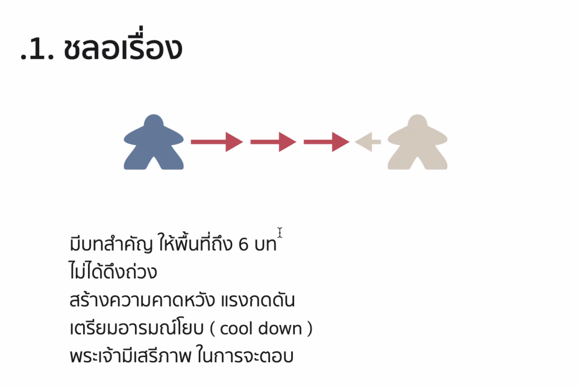

วิดีโอนี้เป็นการเจาะลึกบทบาทของ **เอลีฮู** (Elihu) ในพระธรรมโยบ ซึ่งปกติมักถูกมองข้ามหรืออ่านข้ามไป โดยผู้นำเสนอ (อ.ธนิต และคุณท็อป) ได้วิเคราะห์ว่าเอลีฮูเป็นตัวละครที่มีความสำคัญเชิงศาสนศาสตร์ในฐานะ **'สะพานเชื่อม'** ที่ช่วยปรับมุมมองของโยบให้พร้อมก่อนที่พระเจ้าจะทรงสำแดงพระองค์

### **ข้อมูลเบื้องต้นเกี่ยวกับเอลีฮู:**
*   **ชื่อ:** แปลว่า *'พระเจ้าของฉันคือพระองค์'* (10:10-10:55)
*   **ลักษณะเฉพาะ:** เอลีฮูได้รับบทพูดที่ยาวต่อเนื่องถึง 6 บท (บทที่ 32-37) โดยไม่มีใครขัดจังหวะ และต่างจากเพื่อนคนอื่นๆ ของโยบตรงที่เขามีการเรียกชื่อโยบโดยตรง (15:28-15:32) ซึ่งสะท้อนถึงการใส่ใจในฐานะ 'บุคคล' มากกว่าแค่ถกเถียงเรื่อง 'แนวคิดศาสนศาสตร์' (15:45-16:03)

### **บทบาทสำคัญ 3 ประการ (ตามเนื้อหาช่วงแรก):**
1.  **การชะลอเรื่อง (Delaying):** การเข้ามาของเอลีฮูในบทที่ 32 เป็นการดึงจังหวะก่อนที่พระเจ้าจะตอบโยบ (ในบทที่ 38) การยืดเวลานี้สร้างความคาดหวังที่เข้มข้นขึ้นสำหรับผู้อ่าน และสะท้อนความจริงว่า **พระเจ้ามีเสรีภาพ** ไม่จำเป็นต้องตอบตามกำหนดเวลาหรือข้อเรียกร้องของมนุษย์ (28:10-29:36, 31:37-32:10)
2.  **การขยายแหล่งแห่งปัญญา:** เอลีฮูเปลี่ยนกรอบเดิมที่ว่า 'ปัญญาต้องมาจากคนอายุมากหรือบรรพบุรุษเท่านั้น' (43:09-43:33) โดยชี้ว่าพระเจ้าสามารถประทานความเข้าใจผ่าน **วิญญาณในมนุษย์** (ลมหายใจของพระเจ้า) ทำให้เกิดการรับรู้ปัญญาโดยตรงจากพระองค์ ไม่ใช่ผ่านสื่อกลางหรือธรรมเนียมปฏิบัติเสมอไป (45:00-47:42)
3.  **กรอบความเข้าใจเรื่องความทุกข์:** เอลีฮูเสนอว่าความทุกข์ไม่ใช่แค่ 'บทลงโทษจากบาป' หรือ 'ข้อขัดแย้งในลักษณะพระเจ้า' เท่านั้น แต่เป็น **เครื่องมือของพระเจ้า** ในการตักเตือน ตีสอน และขัดเกลา เพื่อนำมนุษย์กลับมาแสวงหาความสัมพันธ์กับพระเจ้าอย่างแท้จริง (49:34-54:11, 56:24-58:37)

### **สรุปมุมมอง:**
แม้ว่ามุมมองของเอลีฮูจะไม่ใช่คำตอบที่สมบูรณ์แบบที่สุด (1:00:01-1:01:10) แต่เขาก็เป็นตัวละครสำคัญที่มาทำลาย 'กรอบความคิดแคบๆ' ของเพื่อนโยบ เพื่อเตรียมโยบให้พร้อมสำหรับการสำแดงที่ยิ่งใหญ่กว่าจากพระเจ้าในตอนท้ายของเล่ม


วิดีโอนี้เป็นการสรุปบทบาทของ *เอลีฮู* ในพระธรรมโยบ ซึ่งไม่ได้เป็นเพียงตัวละครที่มาแทรกกลางการสนทนา แต่ทำหน้าที่เป็น **“สะพาน”** เพื่อปรับกรอบความคิดของโยบให้พร้อมสำหรับคำตรัสของพระเจ้า (1:20-1:30)

**ประเด็นหลักที่เอลีฮูนำเสนอเพื่อเตรียมความพร้อมให้โยบ:**

1. **ความทุกข์ไม่ได้มีเหตุผลเดียว:** เอลีฮูกระตุ้นให้โยบเห็นว่าความทุกข์ไม่ใช่แค่ผลของบาป แต่เป็นเครื่องมือที่พระเจ้าใช้เพื่อ **ตรัส เตือน และตีสอน** (1:44-2:28)
2. **การตั้งศูนย์ใหม่ (Re-centering):** เอลีฮูช่วยปรับมุมมองของโยบจากที่เคยยึดติดกับ "ความชอบธรรมของตัวเอง" ให้หันมามองที่ "ความชอบธรรมของพระเจ้า" (27:04-27:38)
3. **3 เสาหลักแห่งพระลักษณะของพระเจ้า:** เอลีฮูเชื่อมโยง 3 เรื่องสำคัญเข้าด้วยกัน:
   * **ความชอบธรรม (Righteousness):** พระเจ้าไม่ทำผิด (บทที่ 34:1-9)
   * **ความยุติธรรม (Justice):** พระเจ้าไม่ผันแปรและยุติธรรมเสมอ (บทที่ 34:10-30)
   * **ฤทธานุภาพ (Sovereignty/Power):** พระองค์ทรงยิ่งใหญ่เหนือมนุษย์และไม่ขึ้นอยู่กับผลประโยชน์ของมนุษย์ (บทที่ 36-37)

**สรุปบทบาทของเอลีฮู:**
* เขาไม่ได้มาตอบคำถามว่าทำไมโยบถึงทุกข์ แต่มาเพื่อ **"ตั้งศูนย์ใหม่"** ให้โยบเข้าใจว่าพระเจ้าทรงเป็นศูนย์กลางของทุกสิ่ง (44:08-44:40)
* การที่โยบยึดมั่นในความสัตย์จริงของตัวเองนั้นดี แต่อาจทำให้เขาลืมมองว่าพระเจ้าทรงมีพระปัญญาที่สูงส่งกว่ากรอบจริยธรรมของมนุษย์ (48:06-49:22)
* สิ่งที่เอลีฮูพูดเป็นการเตรียมทางไปสู่ **พระปัญญาของพระเจ้า** ในพระกิตติคุณและการไถ่ของพระเยซูคริสต์ ซึ่งจะเปิดเผยในตอนถัดไป (1:01:07-1:02:40)

## NOTE โยบ32


1️⃣ บทนำ (ข้อ 1–7)
เกริ่นประเด็นและวางท่าที: เอลีฮูเริ่มต้นขอให้โยบเปิดใจรับฟังถ้อยคำของตนอย่างตั้งใจ

คำพูดมาจากใจสัตย์ซื่อ: เอลีฮูยืนยันว่าสิ่งที่ตนจะพูดนั้นมาจากจิตใจที่ซื่อตรง และปัญญาที่มาจากพระวิญญาณของพระเจ้า (ข้อ 4)

ยืนในฐานะมนุษย์เหมือนกัน: เอลีฮูชี้ว่าตนเองถูกสร้างจากดินเหนียวและเป็นมนุษย์เหมือนโยบ โยบจึงไม่ต้องหวาดกลัวหรือรู้สึกถูกกดดันเหมือนเวลาคิดจะขึ้นศาลกับพระเจ้า

2️⃣ อ้างคำกล่าวโทษพระเจ้าของโยบ (ข้อ 8–11)
สรุปข้อกล่าวหาที่โยบเคยพูด: เอลีฮูทบทวนถ้อยคำที่โยบเคยตัดพ้อในบทก่อนๆ โดยแบ่งเป็น 2 ประเด็นหลัก:

โยบอ้างว่าตนบริสุทธิ์: โยบยืนยันว่า "ข้าพเจ้าสะอาด ไม่มีบาปผิด ข้าพเจ้าไร้ราคี" (ข้อ 9)

โยบกล่าวหาว่าพระเจ้าอยุติธรรม: โยบอ้างว่าพระเจ้าทรงหาเรื่องสู้คดีกับตน มองตนเป็นศัตรู และทรงจับเท้าของตนใส่ตรวนไว้ (ข้อ 10–11)

3️⃣ แก้ต่างและกล่าวหักล้างโยบ (ข้อ 12–22)
พระเจ้าทรงยิ่งใหญ่กว่ามนุษย์ (ข้อ 12–13): เอลีฮูแย้งโยบว่า การที่โยบกล่าวหาว่าพระเจ้าไม่ทรงตอบคำถามมนุษย์เลยนั้นไม่เป็นความจริง

พระเจ้าทรงสื่อสารผ่าน 2 ช่องทางหลัก:

ช่องทางที่ 1 (ข้อ 15–18): ความฝันและนิมิตกลางคืน — เพื่อประทับตราคำเตือน ดึงมนุษย์ออกจากความเย่อหยิ่งและการทำชั่ว

ช่องทางที่ 2 (ข้อ 19–22): ความทุกข์ยากและความเจ็บปวดบนที่นอน — พระเจ้าทรงใช้ความเจ็บปวดทางกายภาพเพื่อเบิกหูมนุษย์ เตือนสติไม่ให้ตกไปในหลุมมรณะ

4️⃣ หลักฐานการแนะนำและการฟื้นฟู (ข้อ 23–33)
การทำงานของ "คนกลาง/ทูตสวรรค์" (ข้อ 23–25): หากมีคนกลางสักคนหนึ่งในพันคน มาชี้ทางที่ถูกต้องและไถ่เขาไว้ พระเจ้าจะทรงเมตตาและรักษาร่างกายของเขาให้กลับมาสดชื่นเหมือนวัยหนุ่ม

การสรรเสริญและการขอบพระคุณ (ข้อ 26–28): เมื่อมนุษย์ยอมรับสารภาพบาป พระเจ้าจะทรงกู้ชีวิตเขาออกจากหลุมมรณะ ให้เขาได้เห็นแสงสว่างอีกครั้ง

คำแนะนำและสรุปของเอลีฮู (ข้อ 29–33): เอลีฮูชี้ว่าพระเจ้าทรงทำสิ่งเหล่านี้ซ้ำแล้วซ้ำเล่าเพื่อช่วยชีวิตมนุษย์ และเชิญชวนให้โยบฟังต่อเพื่อที่ตนจะได้สอนสติปัญญาให้


จากที่คุณให้สรุปโครงสร้างของ **พระธรรมโยบ บทที่ 33** ไว้ 4 ส่วน และสอบถามถึง **พระธรรมโยบ บทที่ 34** โดยขอให้สรุปแบบแยกเป็นข้อๆ ในลักษณะเดียวกัน สามารถสรุปและแยกโครงสร้างเนื้อหาของบทที่ 34 ได้ดังนี้ครับ:

---

## 📖 สรุปโครงสร้าง โยบ บทที่ 34 (สุนทรพจน์ที่สองของเอลีฮู)

```
[1. บทนำ]  ----------------->  ข้อ 1–4   (เชิญชวนผู้มีปัญญาให้มาร่วมพิจารณา)
[2. อ้างคำกล่าวโทษของโยบ] --->  ข้อ 5–9   (ทบทวนข้อกล่าวหาที่โยบทำต่อพระเจ้า)
[3. แก้ต่าง]  --------------->  ข้อ 10–30 (โต้แย้งโยบ / ยืนยันความยุติธรรมของพระเจ้า)
[4. หลักฐาน / คำแนะนำ] ------>  ข้อ 31–37 (การยอมรับความผิด / คำแนะนำให้ถ่อมใจกลับใจ)

```

---

### 1️⃣ บทนำ (ข้อ 1–4)

* **เชิญชวนผู้มีปัญญาให้มาร่วมฟัง:** เอลีฮูหันมาพูดกับบรรดา "นักปราชญ์" และ "ผู้มีความรู้" ที่อยู่ในที่นั้น เพื่อให้ช่วยกันไตร่ตรองคำพูดของโยบ
* **การทดสอบถ้อยคำ:** ชี้ว่าหูย่อมทดสอบถ้อยคำ เหมือนลิ้มรสอาหาร ดังนั้น ทุกคนควรร่วมกันพิจารณาและเลือกสิ่งที่ถูกต้องเที่ยงธรรม

---

### 2️⃣ อ้างคำกล่าวโทษของโยบ (ข้อ 5–9)

* **สรุปคำพูดของโยบที่ตั้งตนว่าชอบธรรม:** เอลีฮูทบทวนถ้อยคำที่โยบเคยตัดพ้อไว้ โดยระบุว่าโยบอ้างว่า:
1. *"ข้าพเจ้าชอบธรรม แต่พระเจ้าทรงริบความยุติธรรมไปจากข้าพเจ้า"* (ข้อ 5)
2. โยบรู้สึกว่าตนถูกลงโทษอย่างหนักหน่วง ทั้งๆ ที่ไม่ได้ทำบาปผิดร้ายแรง (ข้อ 6)


* **การประเมินท่าทีของโยบ:** เอลีฮูมองว่าโยบกำลังทำตัวเหมือนคนอธรรมที่เยาะเย้ยพระเจ้า และเผลอคิดไปว่า *"ไม่มีประโยชน์อะไรที่มนุษย์จะเลื่อมใสในพระเจ้า"* (ข้อ 9)

---

### 3️⃣ แก้ต่างและกล่าวหักล้างโยบ (ข้อ 10–30)

* **พระเจ้าไม่ทรงกระทำความชั่ว:** เอลีฮูยืนยันหนักแน่นว่า เป็นไปไม่ได้เลยที่องค์ผู้ทรงมหิทธิฤทธิ์จะทรงอธรรมหรือบิดเบือนความยุติธรรม (ข้อ 10, 12)
* **พระเจ้าทรงสนองตามการกระทำของมนุษย์:** พระเจ้าทรงเป็นผู้ทรงอธิปไตยเหนือโลก หากพระองค์ทรงถอนลมหายใจออก มนุษย์ก็ต้องคืนกลับเป็นผงคลีดิน (ข้อ 14–15)
* **ความเที่ยงตรงที่ไม่มีอคติ:** พระเจ้าทรงมองเห็นวิถีทางของมนุษย์ทุกคน ไม่ทรงเข้าข้างผู้ใหญ่หรือกษัตริย์ และทรงทำลายคนอธรรมโดยไม่ต้องจัดตั้งศาลขึ้นไต่สวนซ้ำ (ข้อ 19–24)

---

### 4️⃣ หลักฐานการแนะนำและคำเตือนสติ (ข้อ 31–37)

* **สิ่งที่โยบควรจะพูด (หลักฐานการยอมจำนน):** มนุษย์ที่เผชิญความทุกข์ควรกล่าวต่อพระเจ้าว่า *"ข้าพระองค์ยอมรับการตีสอนแล้ว ข้าพระองค์จะไม่ทำบาปอีก ขอทรงสอนสิ่งที่ข้าพระองค์มองไม่เห็น"* (ข้อ 31–32)
* **ข้อสรุปและคำเตือนสติโยบ:** เอลีฮูชี้ว่า โยบตอบโต้โดยไร้ความรู้ และการที่โยบยังดื้อดึงแก้ต่างให้ตัวเองนั้น เท่ากับเป็นการเพิ่มความกบฏลงบนความบาปเดิม และเป็นการพูดกล่าวโทษต่อสู้พระเจ้า (ข้อ 35–37)

---

หากมีประเด็นไหนในบทนี้ที่คุณอยากให้ซูมลึกหรือขยายความเพิ่มเติม สามารถบอกได้เลยครับ!


เอลีฮู หน้าที่ 
