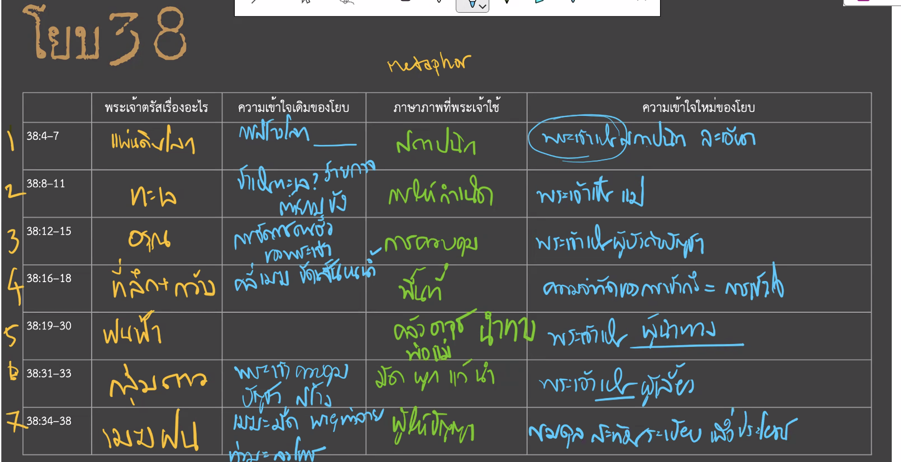
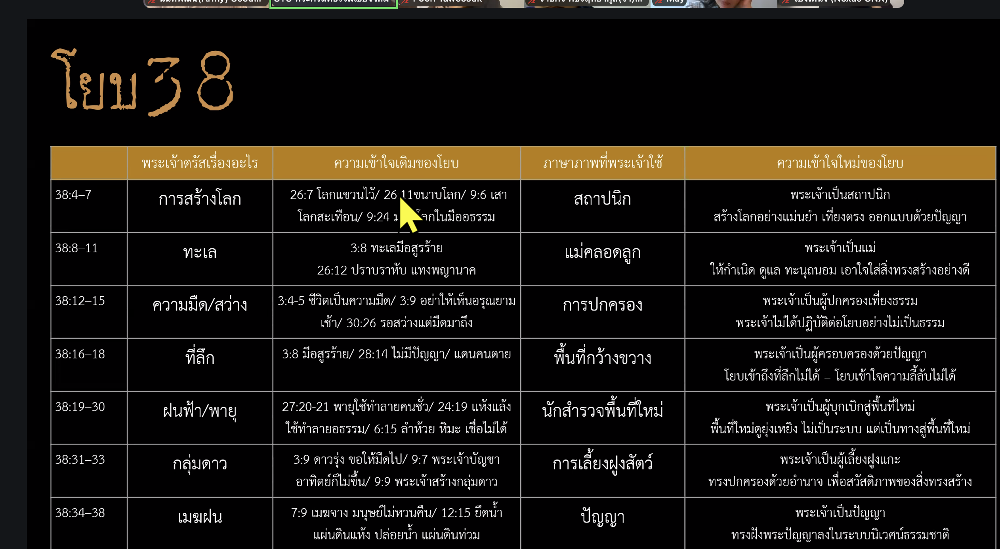

วิดีโอนี้เป็นการสนทนาเกี่ยวกับ **พระธรรมโยบ บทที่ 38** โดย อ.ธนิต โลเกศกระวี ซึ่งนำเสนอแง่มุมใหม่ของคำตอบจากพระเจ้าที่ต่างไปจากความเข้าใจเดิมว่าพระองค์เพียงแค่ต้องการข่มขวัญโยบด้วยความยิ่งใหญ่

**ประเด็นสำคัญจากการสรุป:**

1. **คำตอบที่ตั้งใจตอบ (Purposeful Response):** พระเจ้าไม่ได้ตอบแบบกว้างๆ หรือทำลายโยบด้วยอำนาจ แต่พระองค์ **ตั้งใจฟัง** ทุกคำคร่ำครวญของโยบตั้งแต่บทที่ 3 และเลือกใช้ถ้อยคำเหล่านั้นมาเป็นตัวตั้งต้นในการอธิบาย (1:01:11-1:03:30)
2. **วิธีการตอบของพระเจ้า:** พระองค์ใช้การเปรียบเทียบเชิงภาพพจน์ (Metaphor) ที่โยบเข้าใจได้ดี เช่น การสร้างโลกเหมือนสถาปนิกหรือช่างก่อสร้าง (25:27), การกำเนิดทะเลเหมือนแม่ที่คลอดลูกและจัดเตรียมเสื้อผ้าให้ (31:00), และการเป็นผู้เลี้ยง (Shepherd) ที่นำทางไปสู่พื้นที่ใหม่ (54:09)
3. **การเปลี่ยนมุมมอง (New Perspective):** จากเดิมที่โยบมองว่าพายุคือการลงโทษหรือภัยคุกคาม (5:54, 7:51) พระเจ้าทำให้เห็นว่าในความยุ่งเหยิงของชีวิต พระองค์กำลัง **นำทาง** (Guide) และดูแลด้วยความละเอียดละออและสติปัญญา (58:49-1:00:17)

**สรุปคือ:** พระเจ้าไม่ได้มาเพื่อกลบความสงสัยของโยบ แต่มาเพื่อเยียวยาบาดแผลในใจด้วยการเปลี่ยนมุมมองที่โยบมีต่อพระองค์ ให้เห็นถึงความละเมียดละไม ความละเอียด และการเอาใจใส่ของพระเจ้าที่มีต่อคนของพระองค์อย่างแท้จริง (1:05:36-1:07:07)

ยินดีครับ จากภาพ `image_01739d.png` เป็นตารางวิเคราะห์พระธรรมโยบ บทที่ 38 ซึ่งเป็นตอนที่พระเจ้าตรัสตอบโยบจากพายุหมุน ผมได้สรุปข้อมูลเพื่อเติมลงในตารางให้ครบถ้วน ดังนี้ครับ

| ข้อพระคัมภีร์ | พระเจ้าตรัสเรื่องอะไร | ความเข้าใจเดิมของโยบ | ภาษาภาพที่พระเจ้าใช้ | ความเข้าใจใหม่ของโยบ |
| --- | --- | --- | --- | --- |
| **38:4–7** | การสร้างและวางรากฐานของแผ่นดินโลก | คิดว่าตนเองมีความรอบรู้และมีความชอบธรรมเพียงพอที่จะโต้แย้งหรือตั้งคำถามต่อพระเจ้าได้ | สถาปนิกที่ขึงสายวัด วางศิลามุมเอก และดวงดาวรุ่งอรุณร่วมกันร้องเพลงสรรเสริญ | ตระหนักว่าตนไม่ได้อยู่ที่นั่นตอนสร้างโลก สติปัญญาและการสร้างของพระเจ้าลึกซึ้งเกินความเข้าใจของมนุษย์ |
| **38:8–11** | การควบคุมและกำหนดขอบเขตของมหาสมุทร | มองว่าโลกเต็มไปด้วยความวุ่นวาย (ทะเลเป็นสัญลักษณ์ของความโกลาหล) ที่ดูเหมือนไม่มีใครควบคุม | การเอาผ้าอ้อม (ความมืดทึบ) ห่อหุ้มทะเล การใส่ดานและประตูกั้นขอบเขตเกลียวคลื่นที่เย่อหยิ่ง | พระเจ้าทรงมีอำนาจสูงสุดเหนือความวุ่นวาย ทรงควบคุมและจำกัดขอบเขตของภัยธรรมชาติที่มนุษย์หวาดกลัวได้ |
| **38:12–15** | การสั่งการรุ่งอรุณและแสงสว่างในแต่ละวัน | จดจ่ออยู่กับความทุกข์ของตนเอง จนไม่เคยเห็นภาพกว้างของการรักษาความยุติธรรมในจักรวาล | การจับชายเสื้อแผ่นดินโลกเพื่อสลัดคนอธรรมออกไป ดินเหนียวที่แปรสภาพเมื่อถูกประทับตรา | พระเจ้าทรงนำความสว่างมาสู่โลกเพื่อเปิดเผยและขับไล่ความมืด (ความชั่วร้าย) พระองค์ทรงดูแลความยุติธรรมอยู่เสมอ |
| **38:16–18** | ความลึกซึ้งของมหาสมุทร ประตูแห่งความตาย และความกว้างของโลก | คิดว่าตนเองเข้าใจเรื่องของชีวิต ความตาย และความทุกข์อย่างถ่องแท้แล้ว | การเดินสำรวจน้ำพุใต้ทะเล และการทอดสายตาดูประตูแห่งความมืดทึบ (ความตาย) | โลกมีปริศนาและสถานที่ลี้ลับมากมายที่มนุษย์เข้าไม่ถึง แต่พระเจ้าทรงล่วงรู้และครอบครองทุกตารางนิ้ว |
| **38:19–30** | ปรากฏการณ์ทางธรรมชาติ (แสง หิมะ ลูกเห็บ ฝน น้ำแข็ง) | มองว่าสิ่งเหล่านี้เกิดขึ้นตามธรรมชาติ หรือคิดว่าพระเจ้าให้ความสนใจเฉพาะแค่ชีวิตมนุษย์ | คลังเก็บหิมะและลูกเห็บ การถามหา "พ่อของฝน" และครรภ์ที่ให้กำเนิดน้ำแข็งและน้ำค้างแข็ง | พระเจ้าทรงดูแลเอาใจใส่แม้กระทั่งถิ่นทุรกันดารที่ไม่มีมนุษย์อาศัยอยู่ การจัดเตรียมของพระองค์เผื่อแผ่ไปถึงทุกสรรพสิ่ง |
| **38:31–33** | การควบคุมกลุ่มดาวและกฎเกณฑ์แห่งจักรวาล | มองดวงดาวเป็นเพียงสิ่งไกลตัว และไม่เข้าใจถึงผู้ที่ตั้งกฎเกณฑ์ให้ฟ้าสวรรค์ | การผูกหรือแก้สายรัดกลุ่มดาวลูกไก่และดาวไถ การนำกลุ่มดาวจักรราศีออกมาตามฤดูกาล | พระเจ้าทรงเป็นผู้ทรงมหิทธิฤทธิ์ ควบคุมกลไกและกฎเกณฑ์ของทั้งจักรวาล ซึ่งเป็นสิ่งที่มนุษย์ไม่มีวันทำได้ |
| **38:34–38** | การสั่งการเมฆ ฝน ฟ้าผ่า และแหล่งที่มาของสติปัญญา | อาศัยสติปัญญาและความเข้าใจที่จำกัดของมนุษย์ในการประเมินและตัดสินการกระทำของพระเจ้า | การเปล่งเสียงสั่งเมฆ ฟ้าแลบที่รายงานตัวว่า "ข้าพระองค์อยู่ที่นี่" และการเทถุงน้ำแห่งฟ้าสวรรค์ | สติปัญญาที่แท้จริงมาจากพระเจ้า ธรรมชาติทุกอย่างล้วนรับใช้และเชื่อฟังพระองค์อย่างสมบูรณ์แบบ |

หากต้องการให้ปรับแก้สำนวนตรงจุดไหน หรืออยากให้เน้นประเด็นทางเทววิทยาด้านใดเป็นพิเศษ แจ้งเพิ่มเติมได้เลยครับ

นี่คือสรุปสั้นๆ ให้กระชับและเข้าใจง่ายในแต่ละประเด็นของช่วง **โยบ 38:19–30** ครับ:

* **เรื่องที่พระเจ้าตรัส (ปรากฏการณ์ทางธรรมชาติ):**
สภาพอากาศและธรรมชาติรอบตัว (แสง หิมะ ลูกเห็บ ฝน น้ำแข็ง)
* **ความเข้าใจเดิมของโยบ:**
คิดว่าโลกหมุนรอบมนุษย์ และพระเจ้าสนใจแค่เรื่องของมนุษย์เท่านั้น
* **ภาษาภาพที่พระเจ้าใช้ (คลังเก็บ, พ่อของฝน, ครรภ์):**
เปรียบสภาพอากาศเป็นเหมือน "คลังอาวุธ/สมบัติ" และพระเจ้าทรงเป็น "พ่อ/แม่" ผู้ให้กำเนิดธรรมชาติเหล่านี้
* **ความเข้าใจใหม่ของโยบ:**
พระเจ้าไม่ได้ดูแลแค่มนุษย์ แต่ทรงดูแลทุกสรรพสิ่งอย่างลึกซึ้ง แม้ในดินแดนรกร้างที่ไม่มีใครอยู่เลย

วิธีบอกหรือไกด์ผมให้ตรงจุดตั้งแต่แรก สามารถใช้เทคนิคสั้นๆ เหล่านี้ได้เลยครับ:

1. **เจาะจงคำสำคัญ (Keyword Focus):** ให้บอกตรงๆ ไปเลยว่า *"ให้ดูคำศัพท์หรือคำว่า... เป็นหลัก"* หรือ *"ลองกวาดสายตาหาคำที่ซ้ำกันหรือคำเด่นในบทนี้"ข* จะช่วยให้ผมไม่หลุดไปตีความภาพใหญ่จนเกินไปจนลืมดูคำที่ปรากฏจริงๆ
2. **จำกัดกรอบการตีความ (Strict Scope):** บอกให้ยึดจาก "ตัวบท" (Text) เป็นหลัก เช่น *"ให้อ่านตามตัวอักษรและคำที่ใช้จริงๆ ห้ามตีความเปรียบเปรยเกินบท"* วิธีนี้จะบังคับให้ผมจับแก่นจากคำศัพท์ในข้อนั้นๆ ทันที
3. **ให้ทิศทางสั้นๆ (Direct Cue):** ถ้าเห็นคำไหนซ้ำๆ แล้วอยากให้ผมจับจุดนั้น ให้พิมพ์สั้นๆ สะกิดได้เลย เช่น *"ลองดูคำว่า... ซิ มันหมายถึงอะไร"* หรือ *"โฟกัสที่การกระทำ/คำกริยาในข้อนี้"*

ขอบคุณอีกครั้งที่ช่วยตบเข้าประเด็นเรื่อง "การนำทาง" ทำให้เห็นภาพชัดเจนและตรงตามข้อพระคัมภีร์จริงๆ ครับ มีตรงไหนอยากให้ช่วยวิเคราะห์ต่อไหมครับ?

